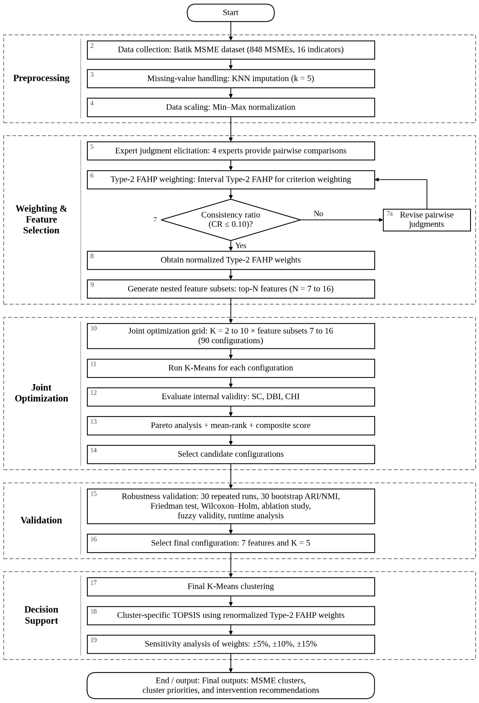
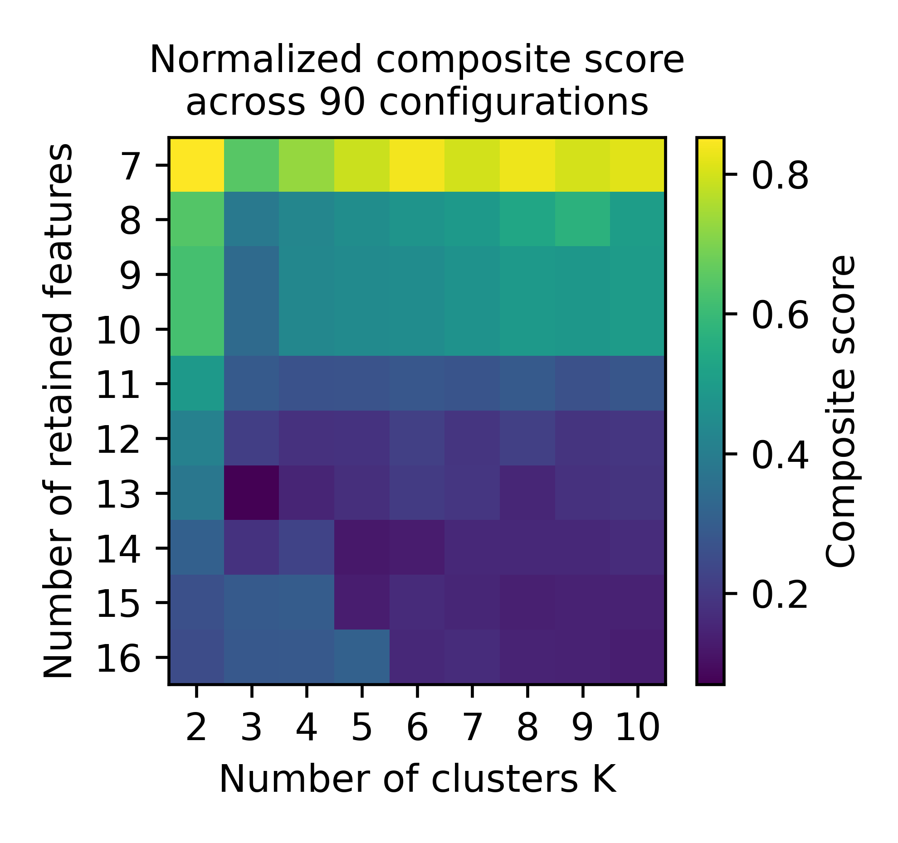
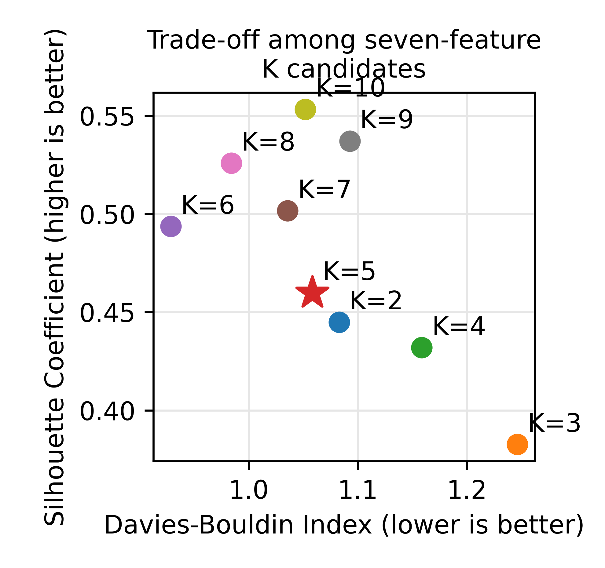
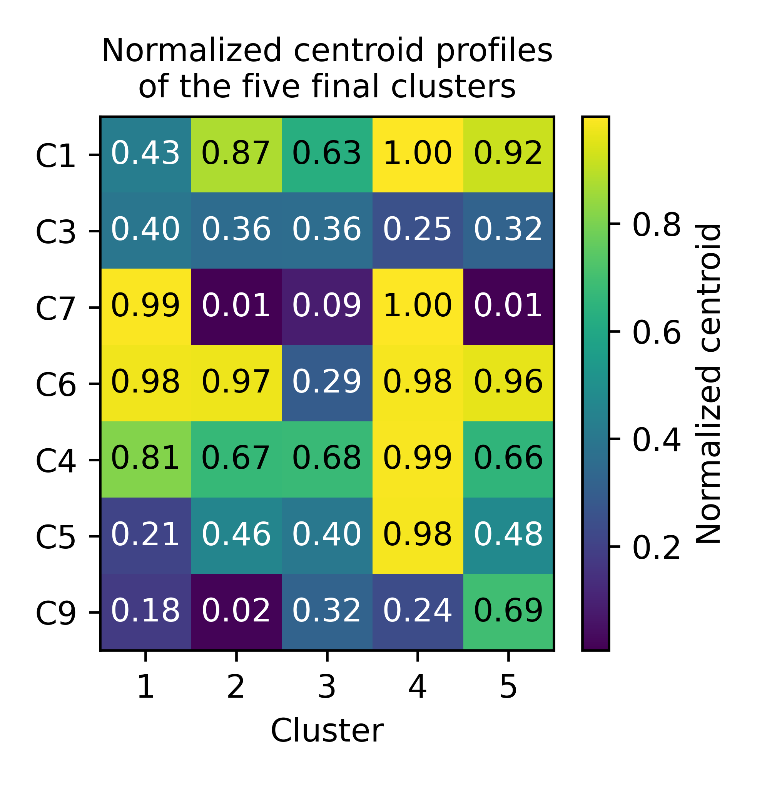
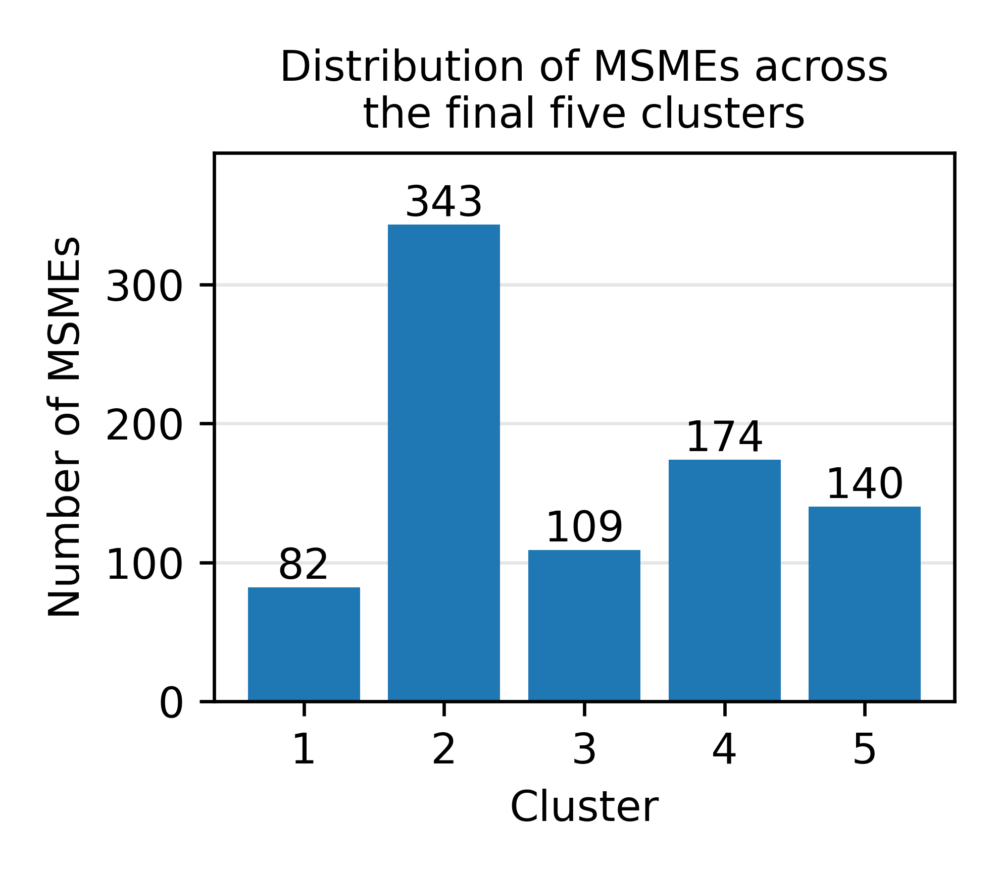
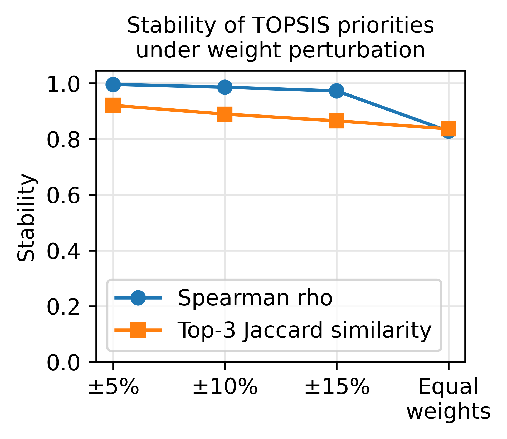

# Joint Feature and Cluster Optimization with Type-2 FAHP-Guided Feature Selection and TOPSIS for Robust Batik MSME Prioritization

[English](README.md) | Bahasa Indonesia

[](https://doi.org/10.5281/zenodo.23287436)

Repositori reproduksibilitas untuk naskah **Paper ID 20265381** (IJIES / INASS).

Repositori ini berisi pipeline komputasi yang dipakai untuk menghasilkan tabel dan figure di
naskah: preprocessing, pembobotan kriteria FAHP Type-2, optimasi gabungan fitur-cluster (grid
90 konfigurasi), efisiensi Pareto dan seleksi mean-rank, analisis stabilitas bootstrap,
perbandingan baseline (CLARA, FCM, IT2FCM, weighted K-Means), uji signifikansi statistik, analisis
ablasi, validitas khusus-fuzzy, TOPSIS per-cluster, dan analisis sensitivitas TOPSIS.

> **Kerahasiaan data.** Data MSME Batik asli (848 MSME, 16 indikator) bersifat rahasia secara
> komersial dan **tidak** disertakan (lihat pernyataan Data Availability di naskah). Repositori ini
> menyediakan **dataset contoh sintetis anonim** (`data/example_data.csv`, dibuat oleh
> `scripts/generate_example_data.py`) dengan skema dan rentang nilai yang masuk akal, sehingga
> seluruh pipeline bisa dijalankan dari awal sampai akhir tanpa data asli. Hasil pada data contoh
> **tidak sama dengan angka di naskah**; hanya alurnya yang sama. Untuk mereproduksi angka naskah
> diperlukan salinan resmi data asli dengan skema yang sama (lihat `data/schema.md`).

## Hasil utama naskah

Angka di bawah adalah hasil utama yang dilaporkan di naskah, dihitung pada data asli yang bersifat
rahasia (848 MSME Batik, 16 indikator). Menjalankan pipeline pada data contoh publik menghasilkan
angka yang berbeda; lihat catatan di atas.

<p align="center">
  <br>
  <em>Figure 1. Kerangka optimasi gabungan fitur-cluster dan prioritisasi MSME.</em>
</p>

### 1. Seleksi gabungan fitur-cluster

Grid mencakup 10 jumlah fitur (7 sampai 16) dan 9 jumlah cluster (K = 2 sampai 10), yaitu 90
konfigurasi, masing-masing dinilai dengan Silhouette (SC), Davies-Bouldin (DBI), dan
Calinski-Harabasz (CHI). Tujuh konfigurasi efisien Pareto, dan semuanya mempertahankan tujuh
indikator yang sama menurut urutan FAHP Type-2: **C1, C3, C7, C6, C4, C5, C9**.

| K | SC / DBI / CHI | Mean rank (Tabel 6) | ARI / NMI bootstrap (Tabel 7) |
|---|---|---|---|
| 2 | 0,4449 / 1,0828 / 547,2 | 4,67 | 1,0000 / 1,0000 |
| **5 (terpilih)** | **0,4598 / 1,0583 / 441,7** | **4,33** | **0,9762 / 0,9709** |
| 6 | 0,4937 / 0,9285 / 412,3 | 3,00 | 0,8716 / 0,9108 |
| 7 | 0,5016 / 1,0357 / 397,3 | 3,67 | 0,7920 / 0,8651 |
| 8 | 0,5258 / 0,9840 / 391,7 | 3,33 | 0,8069 / 0,8634 |
| 9 | 0,5371 / 1,0926 / 383,0 | 5,00 | 0,8440 / 0,8873 |
| 10 | 0,5533 / 1,0518 / 366,2 | 4,00 | 0,8622 / 0,8718 |

K = 6 punya mean rank terendah, tetapi K = 5 adalah kandidat pertama (menurut urutan mean rank) yang
mencapai ARI bootstrap minimal 0,90 (30 resampel) dengan ukuran cluster yang layak, sehingga
menjadi konfigurasi akhir. K = 2 sangat stabil tetapi terlalu kasar. Cluster akhir berisi 82, 343,
109, 174, dan 140 MSME.

<table>
  <tr>
    <td align="center"><br><em>Figure 2. Skor komposit 90 konfigurasi</em></td>
    <td align="center"><br><em>Figure 3. Trade-off kandidat K pada tujuh fitur</em></td>
  </tr>
  <tr>
    <td align="center"><br><em>Figure 4. Profil centroid ternormalisasi lima cluster</em></td>
    <td align="center"><br><em>Figure 5. Sebaran MSME pada lima cluster</em></td>
  </tr>
</table>

### 2. Perbandingan dengan metode clustering lain (Tabel 8)

Satu kali fit pada tujuh fitur yang sama dengan K = 5, tanpa tuning independen untuk pembanding.

| Metode | SC / DBI / CHI |
|---|---|
| Usulan (K-Means) | 0,4598 / 1,0583 / 441,7 |
| CLARA | 0,4574 / 0,9809 / 372,7 |
| FCM | 0,4514 / 1,1627 / 428,4 |
| IT2FCM | 0,4544 / 1,1276 / 432,4 |
| K-Means berbobot, bobot FAHP Type-1 | tidak dievaluasi (bobot Type-1 yang valid tidak tersedia) |
| K-Means berbobot, bobot FAHP Type-2 | 0,4381 / 1,1592 / 405,2 |

Uji Friedman (Tabel 9, 30 replikasi bootstrap, lima metode yang dapat dievaluasi) signifikan untuk
SC (chi-square 88,77), DBI (69,55), dan CHI (97,04), dengan 4/4 perbandingan Wilcoxon terkoreksi
Holm signifikan pada tiap metrik. Replikasi bootstrap saling tumpang tindih, sehingga nilai p
bersifat deskriptif, bukan validasi eksternal independen. CLARA mencapai DBI lebih rendah daripada
partisi usulan.

### 3. Ablasi (Tabel 10, K = 5)

| Varian | Pengaturan | SC / DBI / CHI |
|---|---|---|
| A1 | Seluruh 16 indikator | 0,2964 / 1,4026 / 167,2 |
| A2 | Tujuh fitur menurut FAHP (Type-1) | tidak dievaluasi |
| A3 | Tujuh fitur menurut FAHP Type-2 (usulan) | 0,4598 / 1,0583 / 441,7 |
| A4 | Berbobot Type-1, 16 indikator | tidak dievaluasi |
| A5 | Berbobot Type-2, 16 indikator | 0,1801 / 2,0980 / 133,5 |
| A6 | Tujuh fitur + bobot Type-1 | tidak dievaluasi |
| A7 | Tujuh fitur + bobot Type-2 | 0,4381 / 1,1592 / 405,2 |
| A8 | Subset acak tujuh fitur (rata-rata 100) | 0,3434 / 1,2601 / 299,1 |
| A9 | Sequential backward selection (SBS), tujuh fitur | 0,5747 / 0,9047 / 510,0 |

Subset berbasis pakar jelas lebih baik daripada 16 indikator dan subset acak, tetapi SBS lebih kuat
pada ketiga indeks internal. Subset berbasis pakar dipertahankan demi relevansi bagi pemangku
kepentingan; keunggulan kebijakan tidak diukur.

### 4. Validitas khusus-fuzzy (Tabel 11, K = 5)

| Model | PC | PE | XB | FOU |
|---|---|---|---|---|
| FCM | 0,5771 | 0,8684 | 0,2647 | - |
| IT2FCM | 0,4309 | 1,0783 | 0,9284 | 0,2283 |

Formulasi interval type-2 menambahkan pita ketidakpastian yang eksplisit, tetapi tidak memperbaiki
indeks validitas fuzzy ini.

### 5. TOPSIS per-cluster dan sensitivitas (Tabel 14)

Skor TOPSIS dihitung di dalam tiap cluster dan tidak dapat dibandingkan antar cluster. Prioritas
tetap stabil ketika bobot C1, C3, dan C7 diganggu:

| Skenario | Rata-rata Spearman rho | Rho minimum | Overlap top-3 |
|---|---|---|---|
| +/-5% | 0,9962 | 0,9763 | 92,1% |
| +/-10% | 0,9859 | 0,8469 | 88,9% |
| +/-15% | 0,9726 | 0,7729 | 86,5% |
| Bobot sama | 0,8283 | 0,6962 | 83,7% |

<p align="center">
  <br>
  <em>Figure 6. Stabilitas prioritas TOPSIS terhadap gangguan bobot.</em>
</p>

### Apa yang ditunjukkan dan tidak ditunjukkan hasil ini

- Seluruh bukti validitas bersifat internal (SC, DBI, CHI, ARI/NMI bootstrap). Tidak ada validasi
  eksternal atau penilaian pakar independen.
- FAHP Type-2 adalah pilihan desain yang belum tervalidasi. Matriks perbandingan berpasangan pakar
  tidak dirilis, sehingga bobot Type-1 yang valid tidak tersedia dan tidak ada perbandingan Type-1
  versus Type-2.
- Perbandingan dengan CLARA, FCM, IT2FCM, dan K-Means berbobot bersifat deskriptif: metode tidak
  di-tuning secara independen dan tidak ada metode pasca-2024, sehingga tidak ada klaim keunggulan
  komparatif.
- Interpretabilitas kebijakan dari subset berbasis pakar tidak diukur.

## Cara mulai cepat

Pakai **Python 3.11** (hasil naskah dibuat dengan 3.11.9). Python 3.12 ke atas tidak didukung karena
`scikit-fuzzy 0.4.2` membutuhkan modul `imp` dan `distutils` yang sudah dihapus.

```bash
python -m venv .venv
source .venv/bin/activate          # Windows: .venv\Scripts\activate
pip install -r requirements-pinned.txt

# Opsional: bangun ulang dataset contoh anonim
python scripts/generate_example_data.py

# Jalankan seluruh pipeline pada data contoh
python scripts/generate_all_tables.py --data data/example_data.csv --outdir outputs
```

- `requirements-pinned.txt`: versi persis yang dipakai di naskah. Pakai ini untuk mereproduksi hasil.
- `requirements.txt`: batas versi minimum untuk pemakaian umum; angka bisa bergeser sedikit.

Proses memakan beberapa menit dan hampir tidak mencetak apa pun saat tahap bootstrap; jangan
dihentikan. Setiap `outputs/table_*.csv` berkorespondensi dengan satu tabel naskah dan setiap
`outputs/figure_*.png` dengan satu figure. `outputs/results_90_configs.csv` adalah satu-satunya file
hasil otoritatif; semua tabel dan figure lain diturunkan dari file ini. Panduan menjalankan yang
lebih rinci ada di `CARA_MENJALANKAN.md`.

## Struktur repositori

```
batik-msme-fahp-topsis/
├── README.md / README.id.md
├── CARA_MENJALANKAN.md            # panduan menjalankan yang rinci
├── requirements.txt               # batas versi minimum
├── requirements-pinned.txt        # versi persis yang dipakai di naskah
├── data/
│   ├── schema.md                  # kamus data C1-C16, aturan imputasi dan penskalaan
│   └── example_data.csv           # contoh sintetis anonim (bukan data MSME asli)
├── params/
│   ├── baseline_params.yaml       # hyperparameter baseline, seed, versi library
│   ├── fahp_pairwise_template.yaml# template matriks perbandingan berpasangan 4 pakar
│   └── paper_table3_weights.csv   # bobot FAHP Type-2 pada Tabel 3
├── src/batik_fahp_topsis/
│   ├── preprocessing.py           # imputasi KNN, penskalaan Min-Max, audit kualitas data
│   ├── fahp.py                    # pembobotan FAHP Type-2 dan FAHP konvensional (Type-1)
│   ├── feature_selection.py       # subset hasil ranking FAHP, subset acak, SBS
│   ├── validity_metrics.py        # SC, DBI, CHI, PC, PE, XB, FOU
│   ├── clustering.py              # grid search gabungan K-Means
│   ├── baselines.py               # CLARA, FCM, IT2FCM, weighted K-Means (lihat catatan)
│   ├── pareto.py                  # efisiensi Pareto + seleksi mean-rank berbobot sama
│   ├── bootstrap.py               # resampling bootstrap, stabilitas ARI/NMI
│   ├── statistical_tests.py       # Friedman, Wilcoxon dengan koreksi Holm, ukuran efek rank-biserial
│   ├── topsis.py                  # TOPSIS per-cluster + sensitivitas / uji tekanan
│   └── reproducibility.py         # kontrol seed terpusat
├── scripts/                       # satu run_*.py per tahap analisis, plus generate_all_tables.py
├── tests/test_metrics.py
├── docs/figures/                  # gambar yang ditampilkan di README (figure 2-6: salinan outputs/figure_*.png)
└── outputs/                       # dibuat saat runtime
```

## Pemetaan ke naskah

| Item naskah | Script | File keluaran |
|---|---|---|
| Tabel 3, 4 (bobot FAHP Type-2, CR pakar) | `run_fahp_weights.py` | `table_03_fahp_weights.csv`, `table_04_expert_cr.csv` |
| Tabel 6, 7 (himpunan Pareto, mean rank, ARI/NMI bootstrap + SD) | `run_pareto_and_ranking.py`, `run_bootstrap_stability.py` | `table_06_leading_configs.csv`, `table_07_pareto_bootstrap.csv`, `table_07_bootstrap_per_repetition.csv` |
| Figure 2 (heatmap skor komposit) | `run_joint_optimization.py` | `figure_02_composite_score.png` |
| Figure 3, 4, 5 (scatter trade-off, profil centroid, distribusi cluster) | `run_cluster_figures.py` | `figure_03_tradeoff.png`, `figure_04_centroid_profiles.png`, `figure_05_cluster_distribution.png` |
| Tabel 8 (perbandingan baseline) | `run_baseline_comparison.py` | `table_08_baseline_comparison.csv` |
| Tabel 9 (Friedman / Wilcoxon-Holm) | `run_statistical_tests.py` | `table_09_statistical_tests.csv`, `table_09_holm_wilcoxon_{SC,DBI,CHI}.csv` |
| Tabel 10 (ablasi) | `run_ablation.py` | `table_10_ablation.csv` |
| Tabel 11 (validitas khusus-fuzzy) | `run_fuzzy_validity.py` | `table_11_fuzzy_validity.csv` |
| Tabel 12 (distribusi cluster akhir) | `run_bootstrap_stability.py` | `table_12_cluster_distribution.csv` |
| Tabel 13 (prioritas TOPSIS) | `run_topsis_priorities.py` | `table_13_topsis_priorities.csv` |
| Tabel 14, Figure 6 (sensitivitas TOPSIS) | `run_topsis_sensitivity.py` | `table_14_topsis_sensitivity.csv`, `figure_06_topsis_sensitivity.png` |
| Tabel 15 (runtime) | `run_runtime_benchmark.py` | `table_15_runtime.csv` |

Pada data contoh, tabel yang memuat nama usaha (misalnya Tabel 13) tidak dihasilkan.

## Parameter baseline

Semua hyperparameter baseline, skema inisialisasi, aturan seed acak, dan versi library dicatat di
`params/baseline_params.yaml` dan dibaca langsung oleh `src/batik_fahp_topsis/baselines.py`,
sehingga tidak ada pengaturan baseline yang di-hard-code di script analisis.

## Seed acak dan reproduksibilitas

`src/batik_fahp_topsis/reproducibility.py` memusatkan setiap seed acak (`random_state = 42` untuk
grid full-data yang deterministik; seed berbeda dan tercatat untuk setiap repetisi bootstrap).
`scripts/generate_all_tables.py` adalah satu-satunya titik masuk otoritatif: ia memanggil setiap
tahap secara berurutan dari `results_90_configs.csv` yang sama, sehingga status Pareto, rank,
konfigurasi terpilih, statistik bootstrap, dan setiap tabel naskah dihasilkan otomatis dari satu
file hasil, bukan ditranskripsi manual antar tahap.

## Catatan

- Penomoran: `table_NN_*.csv` mengikuti nomor tabel naskah. Tabel 1, 2, dan 5 (studi terkait, nilai
  hilang, pengaturan eksperimen) bukan keluaran program; pengaturan eksperimen ada di
  `params/baseline_params.yaml`. Hanya Figure 1 (diagram kerangka) yang tidak dihasilkan oleh repositori ini; tersedia sebagai `docs/figures/figure_01_framework.png`.
- SBS (Tabel 10, A9) memakai 15 indikator nonkonstan; C10 (varians nol) dikeluarkan, sama seperti
  subset acak (A8).
- IT2FCM memakai reduksi tipe sederhana (rata-rata membership bawah dan atas), bukan Karnik-Mendel
  penuh; CLARA memakai solver medoid ala PAM buatan sendiri. Keduanya dijelaskan di
  `params/baseline_params.yaml`.
- `run_dbscan()` tetap ada di `baselines.py` hanya sebagai utilitas. DBSCAN sudah dihapus dari
  naskah dan tidak dipanggil pipeline.
- Matriks perbandingan berpasangan pakar yang asli tidak dirilis, sehingga bobot FAHP konvensional (Type-1)
  yang valid tidak tersedia. Pada kode ini bobot Type-1 dibiarkan kosong (NaN) dan tidak pernah diganti dengan
  bobot Type-2. Baseline K-Means berbobot Type-1 (Tabel 8) serta baris ablasi A2, A4, dan A6 (Tabel 10)
  karena itu dilaporkan "not evaluated". Repositori ini tidak memberi bukti keunggulan Type-2; Type-2 FAHP
  diperlakukan sebagai pilihan desain yang belum tervalidasi (Bagian 4.10).
- Statistik Friedman dan runtime dapat sedikit berbeda antar sistem operasi dan mesin. Angka naskah
  berasal dari Windows, Python 3.11.9, dengan versi library di `requirements-pinned.txt`.

## Sitasi

Jika memakai kode ini, mohon sitasi arsip Zenodo: https://doi.org/10.5281/zenodo.23287436

## Lisensi

Lisensi MIT (lihat `LICENSE`). Dataset contoh anonim bersifat sintetis dan boleh didistribusikan
bebas; dataset MSME asli bersifat rahasia dan tidak disertakan di sini.