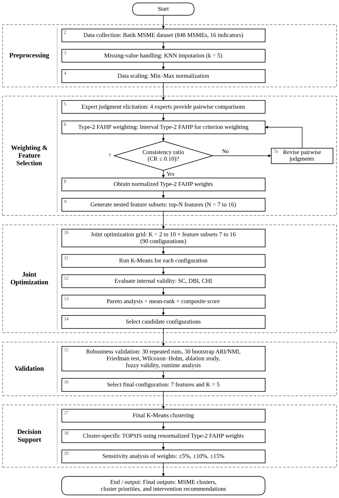
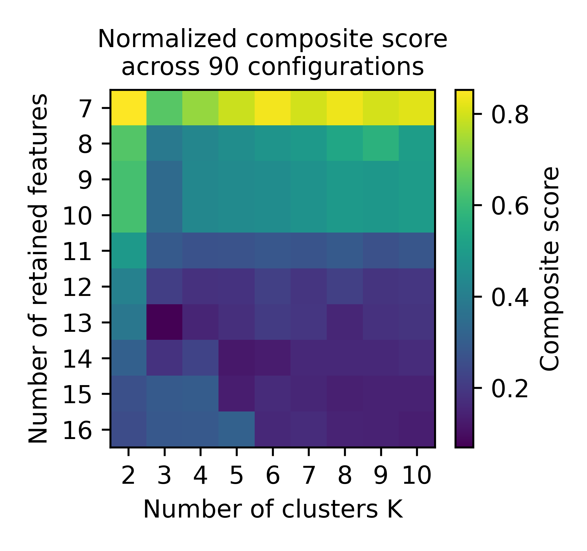
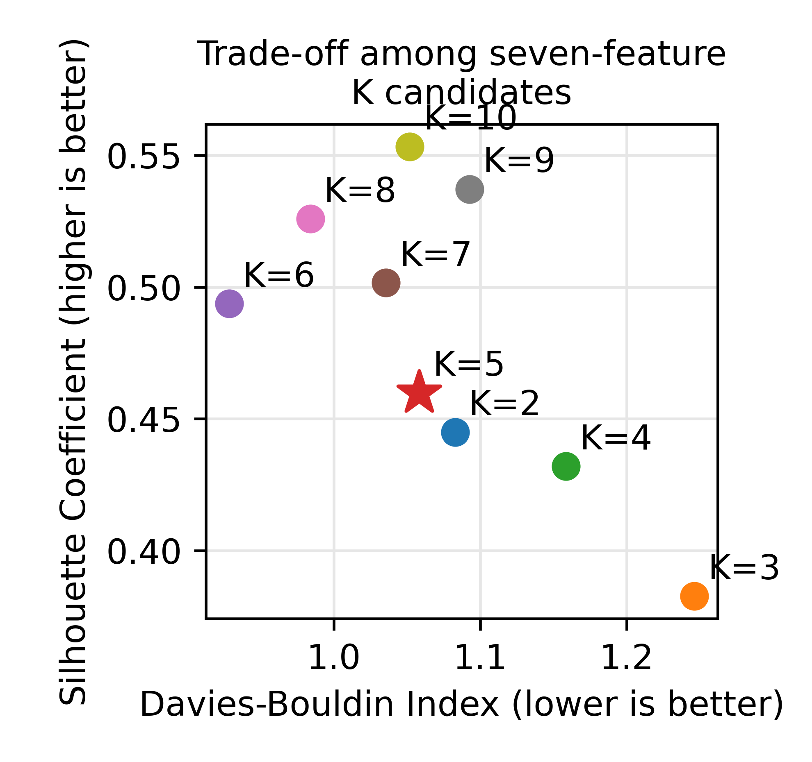
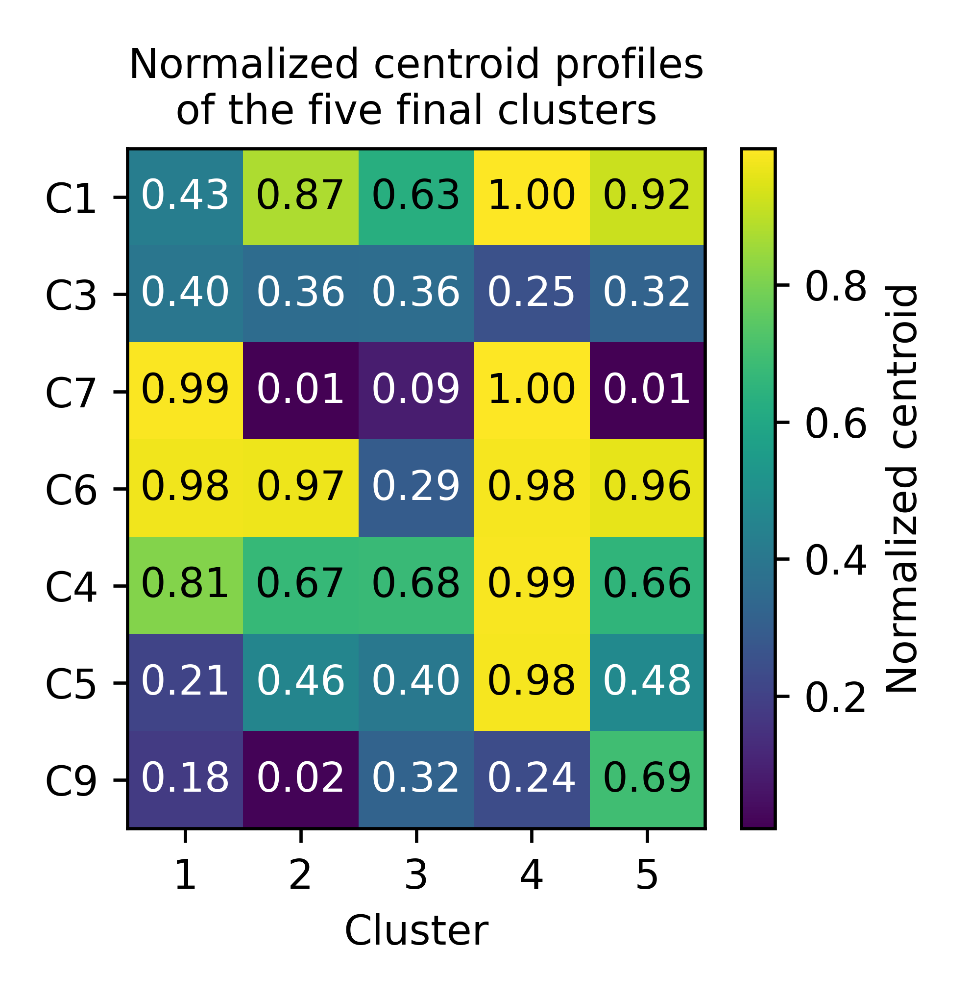
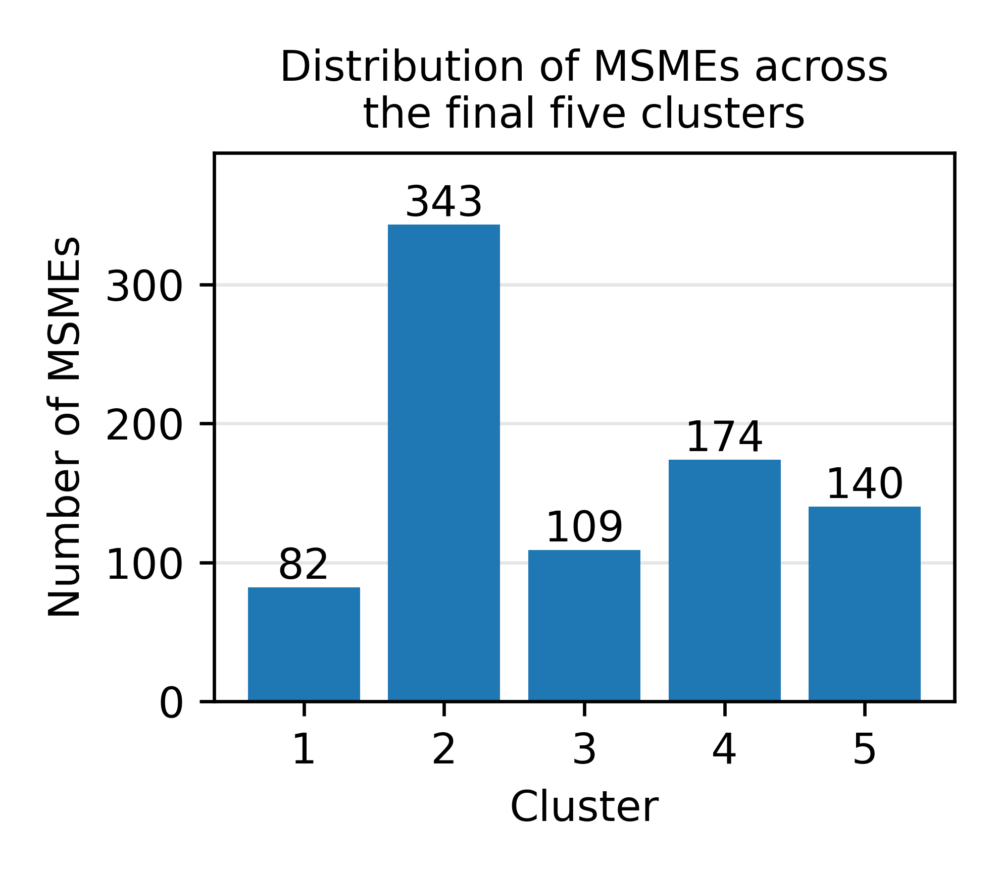
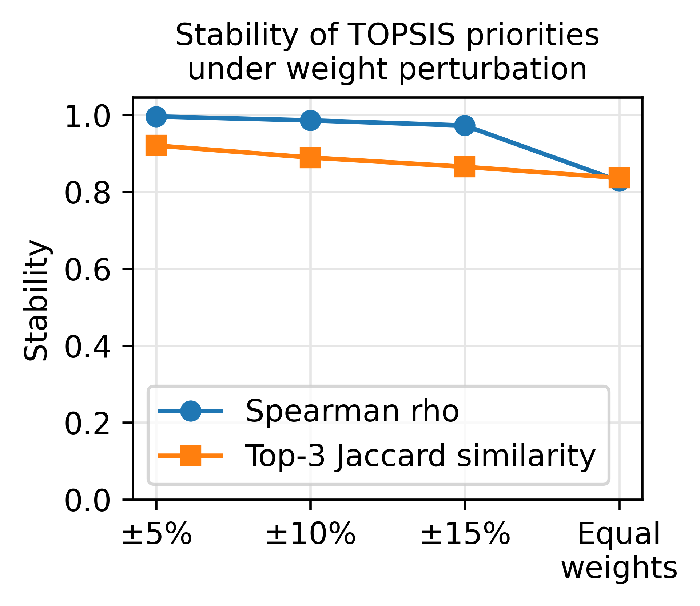

# Joint Feature and Cluster Optimization with Type-2 FAHP-Guided Feature Selection and TOPSIS for Robust Batik MSME Prioritization

[Bahasa Indonesia](README.id.md) | English

[](https://doi.org/10.5281/zenodo.23287436)

Reproducibility repository for manuscript **Paper ID 20265381** (IJIES / INASS).

This repository contains the computational pipeline used to produce the tables and figures of the
manuscript: preprocessing, Type-2 FAHP criterion weighting, joint feature-cluster optimization
(90-configuration grid), Pareto efficiency and mean-rank selection, bootstrap stability analysis,
baseline comparison (CLARA, FCM, IT2FCM, weighted K-Means), statistical significance tests,
ablation analysis, fuzzy-specific validity, cluster-specific TOPSIS, and TOPSIS sensitivity analysis.

> **Data confidentiality.** The original Batik MSME data (848 MSMEs, 16 indicators) are commercially
> confidential and are **not** included (see the Data Availability statement in the manuscript).
> The repository provides an **anonymized synthetic example dataset** (`data/example_data.csv`,
> created by `scripts/generate_example_data.py`) with the same schema and plausible value ranges,
> so the whole pipeline can be run end to end without the original data. Results on the example
> data **do not match the manuscript numbers**; only the workflow is identical. To reproduce the
> manuscript numbers, an authorized copy of the original data with the same schema
> (see `data/schema.md`) is required.

## Key results from the manuscript

The numbers below are the headline results reported in the manuscript, computed on the original
confidential data (848 Batik MSMEs, 16 indicators). Running the pipeline on the public example
data gives different numbers; see the note above.

<p align="center">
  <br>
  <em>Figure 1. Proposed joint feature-cluster optimization and MSME prioritization framework.</em>
</p>

### 1. Joint feature-cluster selection

The grid covers 10 feature counts (7 to 16) and 9 cluster numbers (K = 2 to 10), i.e. 90
configurations, each scored with Silhouette (SC), Davies-Bouldin (DBI) and Calinski-Harabasz (CHI).
Seven configurations are Pareto-efficient, and all of them keep the same seven Type-2 FAHP-ordered
indicators: **C1, C3, C7, C6, C4, C5, C9**.

| K | SC / DBI / CHI | Mean rank (Table 6) | Bootstrap ARI / NMI (Table 7) |
|---|---|---|---|
| 2 | 0.4449 / 1.0828 / 547.2 | 4.67 | 1.0000 / 1.0000 |
| **5 (selected)** | **0.4598 / 1.0583 / 441.7** | **4.33** | **0.9762 / 0.9709** |
| 6 | 0.4937 / 0.9285 / 412.3 | 3.00 | 0.8716 / 0.9108 |
| 7 | 0.5016 / 1.0357 / 397.3 | 3.67 | 0.7920 / 0.8651 |
| 8 | 0.5258 / 0.9840 / 391.7 | 3.33 | 0.8069 / 0.8634 |
| 9 | 0.5371 / 1.0926 / 383.0 | 5.00 | 0.8440 / 0.8873 |
| 10 | 0.5533 / 1.0518 / 366.2 | 4.00 | 0.8622 / 0.8718 |

K = 6 has the lowest mean rank, but K = 5 is the first candidate in mean-rank order that reaches a
bootstrap ARI of at least 0.90 (30 resamples) with usable cluster sizes, so it is the final
configuration. K = 2 is perfectly stable but too coarse. The final clusters contain 82, 343, 109,
174 and 140 MSMEs.

<table>
  <tr>
    <td align="center"><br><em>Figure 2. Composite score over the 90 configurations</em></td>
    <td align="center"><br><em>Figure 3. Trade-off among the seven-feature K candidates</em></td>
  </tr>
  <tr>
    <td align="center"><br><em>Figure 4. Normalized centroid profiles of the five clusters</em></td>
    <td align="center"><br><em>Figure 5. Distribution of MSMEs across the five clusters</em></td>
  </tr>
</table>

### 2. Comparison with other clustering methods (Table 8)

Single fit on the same seven features with K = 5, with no independent tuning of the comparators.

| Method | SC / DBI / CHI |
|---|---|
| Proposed (K-Means) | 0.4598 / 1.0583 / 441.7 |
| CLARA | 0.4574 / 0.9809 / 372.7 |
| FCM | 0.4514 / 1.1627 / 428.4 |
| IT2FCM | 0.4544 / 1.1276 / 432.4 |
| Weighted K-Means, Type-1 FAHP weights | not evaluated (valid Type-1 weights unavailable) |
| Weighted K-Means, Type-2 FAHP weights | 0.4381 / 1.1592 / 405.2 |

Friedman tests (Table 9, 30 bootstrap replicates, five evaluable methods) are significant for SC
(chi-square 88.77), DBI (69.55) and CHI (97.04), with 4/4 Holm-adjusted Wilcoxon comparisons
significant per metric. Bootstrap replicates overlap, so the p-values are descriptive, not
independent external validation. CLARA reaches a lower DBI than the proposed partition.

### 3. Ablation (Table 10, K = 5)

| Variant | Setting | SC / DBI / CHI |
|---|---|---|
| A1 | All 16 indicators | 0.2964 / 1.4026 / 167.2 |
| A2 | FAHP (Type-1) seven features | not evaluated |
| A3 | Type-2 FAHP seven features (proposed) | 0.4598 / 1.0583 / 441.7 |
| A4 | Type-1 weighted, 16 indicators | not evaluated |
| A5 | Type-2 weighted, 16 indicators | 0.1801 / 2.0980 / 133.5 |
| A6 | Seven features + Type-1 weights | not evaluated |
| A7 | Seven features + Type-2 weights | 0.4381 / 1.1592 / 405.2 |
| A8 | Random seven-feature subsets (mean of 100) | 0.3434 / 1.2601 / 299.1 |
| A9 | Sequential backward selection (SBS), seven features | 0.5747 / 0.9047 / 510.0 |

The expert-guided subset clearly beats all 16 indicators and random subsets, but SBS is stronger on
all three internal indices. The expert-guided subset was kept for stakeholder relevance; no
policy advantage was measured.

### 4. Fuzzy-specific validity (Table 11, K = 5)

| Model | PC | PE | XB | FOU |
|---|---|---|---|---|
| FCM | 0.5771 | 0.8684 | 0.2647 | - |
| IT2FCM | 0.4309 | 1.0783 | 0.9284 | 0.2283 |

The interval type-2 formulation adds an explicit uncertainty band but does not improve these fuzzy
validity indices.

### 5. Cluster-specific TOPSIS and sensitivity (Table 14)

TOPSIS scores are computed inside each cluster and are not comparable across clusters. The
priorities stay stable when the weights of C1, C3 and C7 are perturbed:

| Scenario | Mean Spearman rho | Min rho | Top-3 overlap |
|---|---|---|---|
| +/-5% | 0.9962 | 0.9763 | 92.1% |
| +/-10% | 0.9859 | 0.8469 | 88.9% |
| +/-15% | 0.9726 | 0.7729 | 86.5% |
| Equal weights | 0.8283 | 0.6962 | 83.7% |

<p align="center">
  <br>
  <em>Figure 6. Stability of TOPSIS priorities under weight perturbation.</em>
</p>

### What these results do and do not show

- All validity evidence is internal (SC, DBI, CHI, bootstrap ARI/NMI). No external validation or
  independent expert assessment was performed.
- Type-2 FAHP is an unvalidated design choice. The experts' pairwise matrices are not released, so
  valid Type-1 weights are unavailable and no Type-1 versus Type-2 comparison is reported.
- The comparison with CLARA, FCM, IT2FCM and weighted K-Means is descriptive: the methods were not
  independently tuned and no post-2024 method was included, so no claim of comparative
  effectiveness is made.
- Policy interpretability of the expert-guided subset was not measured.

## Quick start

Use **Python 3.11** (the manuscript results were produced with 3.11.9). Python 3.12 or newer is not
supported because `scikit-fuzzy 0.4.2` depends on the removed `imp` and `distutils` modules.

```bash
python -m venv .venv
source .venv/bin/activate          # Windows: .venv\Scripts\activate
pip install -r requirements-pinned.txt

# Optional: regenerate the anonymized example dataset
python scripts/generate_example_data.py

# Run the whole pipeline on the example data
python scripts/generate_all_tables.py --data data/example_data.csv --outdir outputs
```

- `requirements-pinned.txt`: exact versions used in the manuscript. Use this to reproduce results.
- `requirements.txt`: minimum version bounds for general use; numbers may shift slightly.

The run takes a few minutes and prints little during the bootstrap stage; do not interrupt it.
Each `outputs/table_*.csv` corresponds to one manuscript table and each `outputs/figure_*.png` to
one figure. `outputs/results_90_configs.csv` is the single authoritative results file from which
all other tables and figures are derived. A detailed run guide (in Indonesian) is in
`CARA_MENJALANKAN.md`.

## Repository structure

```
batik-msme-fahp-topsis/
├── README.md / README.id.md
├── CARA_MENJALANKAN.md            # detailed run guide (Indonesian)
├── requirements.txt               # minimum version bounds
├── requirements-pinned.txt        # exact versions used in the manuscript
├── data/
│   ├── schema.md                  # data dictionary for C1-C16, imputation and scaling rules
│   └── example_data.csv           # anonymized synthetic example (not real MSME data)
├── params/
│   ├── baseline_params.yaml       # baseline hyperparameters, seeds, library versions
│   ├── fahp_pairwise_template.yaml# template for the four experts' pairwise matrices
│   └── paper_table3_weights.csv   # Type-2 FAHP weights reported in Table 3
├── src/batik_fahp_topsis/
│   ├── preprocessing.py           # KNN imputation, Min-Max scaling, data-quality audit
│   ├── fahp.py                    # Type-2 FAHP and conventional (Type-1) FAHP weighting
│   ├── feature_selection.py       # FAHP-ranked subsets, random subsets, SBS
│   ├── validity_metrics.py        # SC, DBI, CHI, PC, PE, XB, FOU
│   ├── clustering.py              # joint K-Means grid search
│   ├── baselines.py               # CLARA, FCM, IT2FCM, weighted K-Means (see note below)
│   ├── pareto.py                  # Pareto efficiency + equal-weight mean-rank selection
│   ├── bootstrap.py               # bootstrap resampling, ARI/NMI stability
│   ├── statistical_tests.py       # Friedman, Wilcoxon with Holm correction, rank-biserial effect size
│   ├── topsis.py                  # cluster-specific TOPSIS + sensitivity / stress test
│   └── reproducibility.py         # centralized seed control
├── scripts/                       # one run_*.py per analysis stage, plus generate_all_tables.py
├── tests/test_metrics.py
├── docs/figures/                  # figures shown in the README (figures 2-6: copies of outputs/figure_*.png)
└── outputs/                       # created at runtime
```

## Mapping to the manuscript

| Manuscript item | Script | Output file(s) |
|---|---|---|
| Tables 3, 4 (Type-2 FAHP weights, expert CR) | `run_fahp_weights.py` | `table_03_fahp_weights.csv`, `table_04_expert_cr.csv` |
| Tables 6, 7 (Pareto set, mean rank, bootstrap ARI/NMI + SD) | `run_pareto_and_ranking.py`, `run_bootstrap_stability.py` | `table_06_leading_configs.csv`, `table_07_pareto_bootstrap.csv`, `table_07_bootstrap_per_repetition.csv` |
| Figure 2 (composite-score heatmap) | `run_joint_optimization.py` | `figure_02_composite_score.png` |
| Figures 3, 4, 5 (trade-off scatter, centroid profiles, cluster distribution) | `run_cluster_figures.py` | `figure_03_tradeoff.png`, `figure_04_centroid_profiles.png`, `figure_05_cluster_distribution.png` |
| Table 8 (baseline comparison) | `run_baseline_comparison.py` | `table_08_baseline_comparison.csv` |
| Table 9 (Friedman / Wilcoxon-Holm) | `run_statistical_tests.py` | `table_09_statistical_tests.csv`, `table_09_holm_wilcoxon_{SC,DBI,CHI}.csv` |
| Table 10 (ablation) | `run_ablation.py` | `table_10_ablation.csv` |
| Table 11 (fuzzy-specific validity) | `run_fuzzy_validity.py` | `table_11_fuzzy_validity.csv` |
| Table 12 (final cluster distribution) | `run_bootstrap_stability.py` | `table_12_cluster_distribution.csv` |
| Table 13 (TOPSIS priorities) | `run_topsis_priorities.py` | `table_13_topsis_priorities.csv` |
| Table 14, Figure 6 (TOPSIS sensitivity) | `run_topsis_sensitivity.py` | `table_14_topsis_sensitivity.csv`, `figure_06_topsis_sensitivity.png` |
| Table 15 (runtime) | `run_runtime_benchmark.py` | `table_15_runtime.csv` |

On the example data, tables that contain business names (for example Table 13) are not produced.

## Baseline parameters

All baseline hyperparameters, initialization schemes, random-seed rules, and library versions are
recorded in `params/baseline_params.yaml` and read directly by
`src/batik_fahp_topsis/baselines.py`, so no baseline setting is hard-coded in the analysis scripts.

## Random seeds and reproducibility

`src/batik_fahp_topsis/reproducibility.py` centralizes every random seed (`random_state = 42` for
the deterministic full-data grid; distinct, recorded seeds for each bootstrap repetition).
`scripts/generate_all_tables.py` is the single authoritative entry point: it calls each stage in
order from the same `results_90_configs.csv`, so Pareto status, ranks, the selected configuration,
bootstrap statistics, and every manuscript table are generated automatically from one results
file rather than transcribed by hand between stages.

## Notes

- Table numbering: `table_NN_*.csv` follows the manuscript table numbers. Tables 1, 2, and 5
  (related work, missing values, experimental settings) are not program outputs; experimental
  settings are in `params/baseline_params.yaml`. Only Figure 1 (framework diagram) is not generated by
  this repository; it is provided as `docs/figures/figure_01_framework.png`.
- SBS (Table 10, A9) uses the 15 nonconstant indicators; C10 (zero variance) is excluded, as for
  the random subsets (A8).
- IT2FCM uses a simplified type reduction (averaging the lower and upper memberships) rather than
  full Karnik-Mendel; CLARA uses a self-written PAM-style medoid solver. Both are described in
  `params/baseline_params.yaml`.
- `run_dbscan()` remains in `baselines.py` only as a utility. DBSCAN was removed from the manuscript
  and is not called by the pipeline.
- The experts' individual pairwise comparison matrices are not released, so valid conventional (Type-1)
  FAHP weights are unavailable. In this code the Type-1 weights stay empty (NaN) and are never replaced
  by Type-2 weights. The Type-1 weighted K-Means baseline (Table 8) and ablation rows A2, A4 and A6
  (Table 10) are therefore reported as "not evaluated". The repository gives no evidence of a Type-2
  advantage; Type-2 FAHP is treated as an unvalidated design choice (Section 4.10).
- Friedman statistics and runtimes can differ slightly across operating systems and machines. The
  manuscript numbers were produced on Windows with Python 3.11.9 and the versions in
  `requirements-pinned.txt`.

## Citation

If you use this code, please cite the Zenodo archive: https://doi.org/10.5281/zenodo.23287436

## License

MIT License (see `LICENSE`). The anonymized example dataset is synthetic and may be freely
distributed; the original MSME dataset is confidential and is not included here.